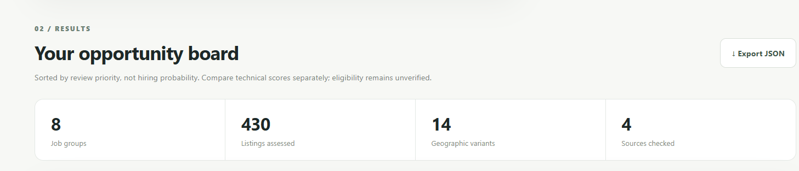
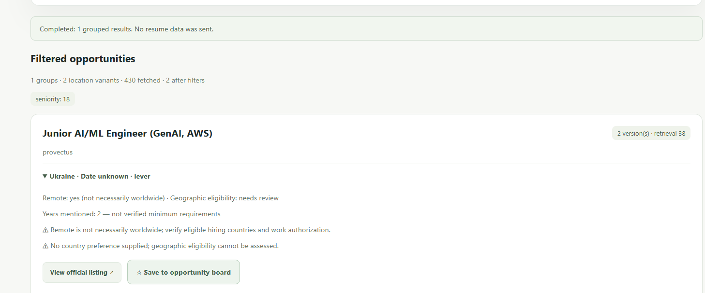
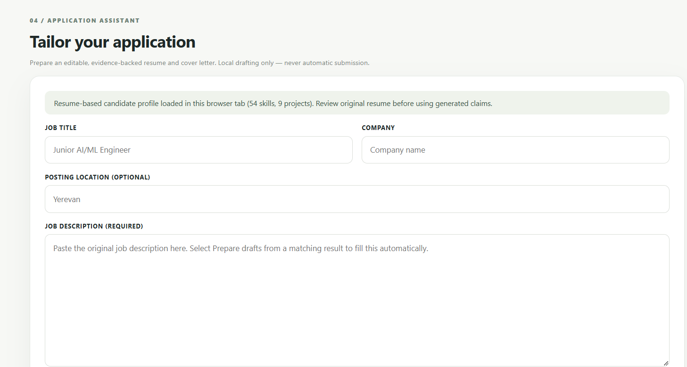
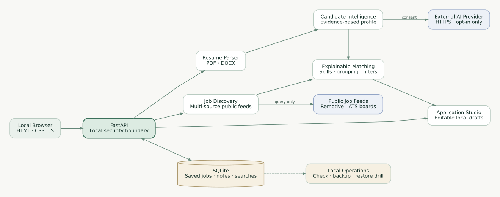

<div align="center">

# CareerPilot AI

### An Explainable AI-Powered Job Intelligence & Application Workspace

**From resume understanding to evidence-backed opportunities and application drafts.**

[](https://www.python.org/)
[](https://fastapi.tiangolo.com/)
[](https://github.com/mahmmooudian/careerpilot-ai/actions/workflows/ci.yml)


**[Overview](#overview) · [Architecture](#high-level-architecture) · [Quick Start](#quick-start) · [Documentation](#documentation) · [Release](https://github.com/mahmmooudian/careerpilot-ai/releases/tag/v1.0.0-local)**

</div>

---

## Overview

Finding a relevant position requires more than collecting vacancy links. Candidates must translate a resume into structured evidence, compare inconsistent job descriptions, distinguish technical alignment from actual eligibility, track opportunities across hiring platforms, and prepare tailored applications without overstating their experience.

**CareerPilot AI** is a **local-first, single-user job intelligence platform** built with Python and FastAPI. It unifies document parsing, consent-gated AI profile extraction, multi-source job discovery, explainable matching, advanced filtering, opportunity tracking, and editable application drafting in one browser-based workspace.

The system is designed to **support human decisions—not automate hiring decisions or job applications**. Relevance scores indicate technical alignment for review; they do not predict interview or hiring probability.

### The problem and the approach

| Challenge | CareerPilot AI approach |
|---|---|
| Unstructured resumes | Local PDF/DOCX parsing and optional, consent-gated structured profile extraction |
| Fragmented vacancy sources | Normalized discovery across supported public job feeds |
| Repeated listings across locations | Job grouping while preserving individual geographic variants |
| Opaque job recommendations | Inspectable technical relevance and explicit review warnings |
| Scattered application tracking | Local SQLite opportunity board and manual search baselines |
| Generic application material | Editable drafts grounded in the candidate profile and original job description |

---

## Key Capabilities

### 1. Resume Intelligence

- Parse PDF and DOCX resumes locally, with input validation and readable error responses.
- Optionally extract a structured candidate profile through a configured OpenAI-compatible AI provider **only after explicit user consent**.
- Organize skills, experience, roles, and projects into reusable candidate evidence.
- Surface extraction warnings and require verification against the original resume.

### 2. Multi-Source Job Discovery

- Search the **Remotive** public feed and optionally configured **Greenhouse, Lever, and Ashby** public employer boards.
- Normalize listings from different providers into comparable records.
- Retrieve opportunities across multiple target roles and group related postings.
- Preserve separate locations and original posting links instead of collapsing geographic requirements.

### 3. Explainable Job Matching

- Compare candidate evidence with job titles, technologies, and description content.
- Produce deterministic, review-oriented technical relevance scores.
- Distinguish matched information from missing or unverified requirements.
- Flag remote-work and geographic eligibility assumptions for manual investigation.

### 4. Advanced Job Intelligence

- Filter results by role seniority, source, location, keywords, remote status, description quality, and available publication-age metadata.
- Treat unknown posting dates as **unknown**, not automatically recent.
- Save search configurations locally and manually compare newly observed listing URLs against a previous check.
- Keep location-specific variants visible within a grouped opportunity.

### 5. Opportunity Management

- Save opportunities to a local SQLite database.
- Track application stages, notes, follow-up dates, interview details, and activity history.
- Keep user-entered tracking actions separate from actual submissions to employers.
- Verify database integrity and create consistent private backups.

### 6. Application Assistant

- Generate editable, job-specific **resume text and cover-letter drafts** from a supplied candidate profile and job description.
- Identify skill alignment and technologies that still need verification.
- Use a **local deterministic drafting workflow**; drafting does not make an additional LLM call.
- Require human editing and fact-checking before the documents are used.

---

## Product Preview

*Screenshots are from a local development session. Job counts illustrate one run, not guaranteed live availability or benchmark performance.*

| Discover & Match | Advanced Job Intelligence |
|:---:|:---:|
|  |  |

**Application Studio**



---

## High-Level Architecture

CareerPilot AI follows a modular, API-driven architecture with **explicit boundaries between local processing, authorized external requests, and persistent user state**.



**Architectural layers**

| Layer | Main responsibility | Implementation |
|---|---|---|
| Presentation | Search, inspect, track, and prepare applications | Same-origin HTML, CSS, and JavaScript dashboard |
| API & validation | Route requests and validate inputs | FastAPI, Pydantic |
| Resume intelligence | Parse resumes; request optional AI profile extraction | PyMuPDF, python-docx, configured LLM provider |
| Job intelligence | Retrieve, normalize, group, filter, and rank listings | Public ATS feeds, HTTPX, deterministic matching |
| Application preparation | Compose editable drafts with evidence-review indicators | Local deterministic text generation |
| Persistence | Save opportunity metadata, notes, stages, and search baselines | SQLite |
| Operations & security | Local access checks, integrity, backups, and release checks | Middleware and `app.ops` commands |

**Trust boundaries:** PDF/DOCX parsing, job tracking, and application drafting run locally. Job providers receive job-search parameters, **not the uploaded resume**. Resume-derived content is sent to the configured AI provider **only with explicit consent**. The API is intended for localhost, not a publicly exposed multi-user service.

For component responsibilities, data-flow details, and design trade-offs, see [Technical Architecture](docs/architecture.md) and [Engineering Design Decisions](docs/design-decisions.md).

---

## Technical Core & Workflow

```text
Candidate resume (PDF / DOCX)
          |
          v
Local parsing and validation
          |
          +---- Explicit consent ----> External LLM profile extraction
          |                                        |
          +----------------------------------------+
                           |
                           v
                Structured candidate profile
                           |
                           v
 Public job feeds --> Normalize --> Group geographic variants
                           |
                           v
                Explainable relevance review
                           |
              +------------+-------------+
              |                          |
              v                          v
      Advanced job filters        Saved opportunity board
              |                          |
              +------------+-------------+
                           |
                           v
            Human review + original job description
                           |
                           v
          Local resume / cover-letter text drafts
                           |
                           v
                User edits and applies manually
```

### Matching and decision boundaries

Matching is **heuristic and explainable**, not a supervised model trained on hiring outcomes. The system supports relevance review and flags uncertainty around work authorization, remote eligibility, and experience requirements. Neither a high score nor a remote-work label constitutes an eligibility decision.

### Search-history semantics

A saved search compares observed listing **URLs** with an earlier manually recorded baseline. A newly observed URL is **not proof that a vacancy was recently published**. There is no background scheduler or automatic alert delivery in this release.

### Application-drafting semantics

The application assistant composes editable text using supplied profile evidence and the original job posting. The user must confirm dates, skills, experience, and other claims. It does **not** submit applications or communicate with employers.

---

## Results & Verification

The version `v1.0.0-local` was validated with automated tests and a local database recovery exercise. These figures describe **engineering verification**, not predictive model accuracy.

| Validation area | Verified outcome |
|---|---|
| Automated testing | **178 pytest checks passed** in the release validation |
| Continuous integration | Successful GitHub Actions jobs on **Python 3.10 and 3.11** |
| Database recovery | Isolated-memory SQLite restore drill completed against a private backup |
| Release checks | Local-readiness checks passed in the configured development environment |
| Browser interface | Job discovery, advanced filtering, and saved-opportunity views exercised locally |

One development-session dashboard displayed **430 listings assessed, 8 job groups, and 14 geographic variants** across configured sources. This is an **illustrative snapshot** and should not be interpreted as a repeatable benchmark, a guarantee of current vacancy availability, or hiring-performance evidence.

```powershell
python -m pytest -q
python -m app.ops check
python -m app.ops release-check
```

The GitHub Actions workflow is available in [`.github/workflows/ci.yml`](.github/workflows/ci.yml). Live job-provider availability, external AI responses, and Docker behavior vary by environment and require separate checks.

---

## Quick Start

### Requirements

- Python **3.10+** and Windows PowerShell (Windows 10/11 recommended for the documented commands).
- Internet access to install dependencies and search external public job sources.
- An AI provider API key **only if** using opt-in resume profile extraction.
- Docker Desktop is optional; it is not required for the native setup.

### 1. Clone and create an environment

```powershell
git clone https://github.com/mahmmooudian/careerpilot-ai.git
cd careerpilot-ai
py -3 -m venv .venv
.\.venv\Scripts\python.exe -m pip install --upgrade pip
.\.venv\Scripts\python.exe -m pip install -e ".[dev]"
```

### 2. Configure local settings

```powershell
Copy-Item .env.example .env
```

Edit `.env` on your own machine. For AI-assisted candidate profile extraction, configure `AI_API_KEY`, `AI_BASE_URL`, and `AI_MODEL`. If you do not intend to use external AI processing, leave `AI_API_KEY` empty. **Never commit `.env` or publish tokens.** Public-feed discovery does not require an AI key.

Optional employer board configuration uses the public identifiers `JOB_GREENHOUSE_BOARDS`, `JOB_LEVER_SITES`, and `JOB_ASHBY_BOARDS`; `JOB_REMOTIVE_ENABLED` controls the Remotive feed.

### 3. Run tests and start the app

```powershell
.\.venv\Scripts\python.exe -m pytest -q
.\.venv\Scripts\python.exe -m uvicorn app.main:app --host 127.0.0.1 --port 8000
```

**Dashboard:** http://127.0.0.1:8000/app  
**Interactive API docs:** http://127.0.0.1:8000/docs  
**Health endpoint:** http://127.0.0.1:8000/health

> `release-check` checks full local-release configuration and can report incomplete readiness when no AI API key is configured; this does not necessarily prevent public job searching.

Detailed installation: [Windows Setup Guide](docs/setup-windows.md).

---

## Usage

| Workspace | Typical task | Important constraint |
|---|---|---|
| **Discover & Match** | Parse or analyze a resume, discover jobs, and inspect ranked groups | External profile analysis requires explicit consent |
| **Advanced Intelligence** | Filter vacancies and review location variants | Dates and eligibility may be unknown |
| **Saved Opportunities** | Record stage, notes, follow-ups, and interviews | A saved or updated record is **not** an application submission |
| **Application Studio** | Draft editable resume and cover-letter text | Original description and profile evidence must be supplied and reviewed |

### Selected API endpoints

| Method | Endpoint | Description |
|---|---|---|
| `POST` | `/api/v1/resumes/parse` | Local PDF/DOCX parsing |
| `POST` | `/api/v1/resumes/analyze` | Consent-gated AI profile extraction |
| `GET` | `/api/v1/jobs/search` | Public job discovery |
| `POST` | `/api/v1/jobs/recommend` | Candidate-aware relevance review |
| `GET` | `/api/v1/jobs/intelligence/search` | Advanced job intelligence |
| `GET` / `POST` / `PATCH` / `DELETE` | `/api/v1/opportunities` | Local opportunity management (item routes vary) |
| `GET` / `POST` / `DELETE` | `/api/v1/job-watches` | Saved job searches |
| `POST` | `/api/v1/job-watches/{identifier}/check` | Manual search comparison |
| `POST` | `/api/v1/application/draft` | Local application drafting |

See `/docs` for the full route catalogue and validated request/response schemas.

### Local database backup and restore check

```powershell
$backupDir = "$env:USERPROFILE\Documents\CareerPilotBackups"
New-Item -ItemType Directory -Force -Path $backupDir

.\.venv\Scripts\python.exe -m app.ops backup --destination $backupDir

$backup = Get-ChildItem "$backupDir\careerpilot_backup_*.sqlite3" |
  Sort-Object LastWriteTime -Descending |
  Select-Object -First 1

.\.venv\Scripts\python.exe -m app.ops restore-drill --backup "$($backup.FullName)"
```

The restore drill uses an **isolated in-memory database** and leaves the live SQLite database unchanged. Store backups outside the repository; they may contain private job notes and search preferences.

### Optional Docker Compose

```bash
docker compose up --build -d
docker compose ps
```

Compose is configured for **localhost-only host binding** and uses a Docker volume separate from a native Windows installation. Container startup must still be verified on the target machine. Do not expose the service publicly.

---

## Technology Stack

| Category | Technologies |
|---|---|
| Programming & backend | Python 3.10+, FastAPI, Pydantic v2 |
| AI-assisted extraction | OpenAI-compatible chat-completion API (Groq example configuration) |
| Document intelligence | PyMuPDF, python-docx |
| HTTP and source integration | HTTPX, Remotive, Greenhouse, Lever, Ashby public feeds |
| Persistence | SQLite |
| Frontend | HTML5, CSS3, Vanilla JavaScript |
| Testing & CI | pytest, GitHub Actions (Python 3.10 / 3.11) |
| Packaging & local operation | Uvicorn, Docker, Docker Compose |

---

## Project Structure

```text
careerpilot-ai/
├── app/
│   ├── api/                   # FastAPI endpoints
│   ├── core/                  # Configuration, local security, release checks
│   ├── ops/                   # Health, backup, restore and release CLI
│   ├── schemas/               # Pydantic data models
│   ├── services/              # Resume, discovery, ranking, drafting, SQLite
│   ├── web/                   # Browser dashboard assets
│   └── main.py                # FastAPI application entry point
├── tests/                     # Automated test suite
├── docs/
│   ├── assets/                # Architecture diagram
│   ├── screenshots/           # Sanitized dashboard previews
│   ├── architecture.md
│   ├── design-decisions.md
│   ├── setup-windows.md
│   └── release-checklist.md
├── .github/workflows/ci.yml   # Python version-matrix CI
├── .env.example               # Non-secret configuration template
├── .gitignore
├── .dockerignore
├── Dockerfile
├── compose.yaml
├── pyproject.toml
├── CHANGELOG.md
├── SECURITY.md
└── README.md
```

---

## Engineering Principles

**Evidence over speculation.** Resume-derived information and job requirements are presented with verification boundaries rather than as automatically trusted facts.

**Explainability over black-box scores.** The matching component produces inspectable relevance indicators, not unsupported hiring predictions.

**Privacy by design within local scope.** Parsing and drafting are local. Sending resume-derived text to an external AI provider is explicitly opt-in; saved tracking state is stored in local SQLite.

**Human-in-the-loop execution.** Users review every recommendation and draft. The system does not submit applications, message recruiters, or modify employer platforms.

**Modularity and testability.** API contracts, domain services, browser assets, operational tooling, and persistence are separated for maintainability and regression testing.

**Clear operational limits.** Local-only access restrictions and backup checks are safeguards, **not substitutes for authentication or a complete production security review**.

---

## Current Scope & Limitations

> [!WARNING]
> **CareerPilot AI v1.0 is a local, single-user application—not a publicly hosted SaaS or multi-user service.** Do not expose its API over public networks or tunnels without implementing a separate authentication and security architecture.

- **No employment prediction:** Technical match scores do not estimate hiring probability or confirm eligibility.
- **No automated applications:** No auto-apply, recruiter messaging, or direct employer account actions.
- **No LinkedIn scraping:** Discovery is based on the implemented public-source integrations.
- **No scheduled monitoring:** Saved-search checks are manually initiated; URL novelty does not establish posting freshness.
- **No independent verification of resume claims:** AI profile extraction can be incomplete or inaccurate; drafts require user approval and editing.
- **No default full-context handoff from saved jobs:** The Application Studio may require the original job description and candidate profile to be supplied again.
- **No public deployment security:** Multi-user authentication, hosted access controls, and public-serving TLS are outside the v1.0 scope.
- **No at-rest encryption:** The application does not encrypt its SQLite database or backup files.
- **External dependencies vary:** Providers may become unavailable, change APIs, or rate-limit requests; Docker has not been validated on every target computer.

See [Security & Privacy](SECURITY.md) for additional operational requirements.

---

## Roadmap

The v1.0 feature set is intentionally frozen. Potential future improvements are **proposals, not implemented features**:

- Smoother saved-opportunity → Application Studio context handoff.
- More authorized job-provider integrations and configurable discovery policies.
- Opt-in scheduling and notifications for saved searches.
- Richer draft export and review workflows.
- Stronger deployment architecture, account-based access controls, monitoring, and automated security checks.

---

## Documentation

| Resource | Description |
|---|---|
| [Technical Architecture](docs/architecture.md) | Modules, data flow, and trust boundaries |
| [Engineering Design Decisions](docs/design-decisions.md) | Rationale and trade-offs |
| [Windows Setup](docs/setup-windows.md) | Fresh installation and safe local operation |
| [Security & Privacy](SECURITY.md) | Supported scope and known risks |
| [Release Checklist](docs/release-checklist.md) | Verification and publication safeguards |
| [Changelog](CHANGELOG.md) | Release evolution |
| [v1.0.0-local Release](https://github.com/mahmmooudian/careerpilot-ai/releases/tag/v1.0.0-local) | Versioned release notes |

---

## Author

**Amir Mohammad Mahmoudian**  
AI Engineer & Researcher  
[GitHub](https://github.com/mahmmooudian) · [Portfolio](https://sites.google.com/view/mahmoudian/home)

## License

**No open-source license has been selected for this repository.** The code is publicly visible, but public visibility alone does not grant permission to redistribute, modify, or use it under an open-source license. A `LICENSE` file may be added later at the repository owner's discretion.

---

<div align="center">

**CareerPilot AI** · Understand the evidence. Explore opportunities. Apply with intention.

</div>
