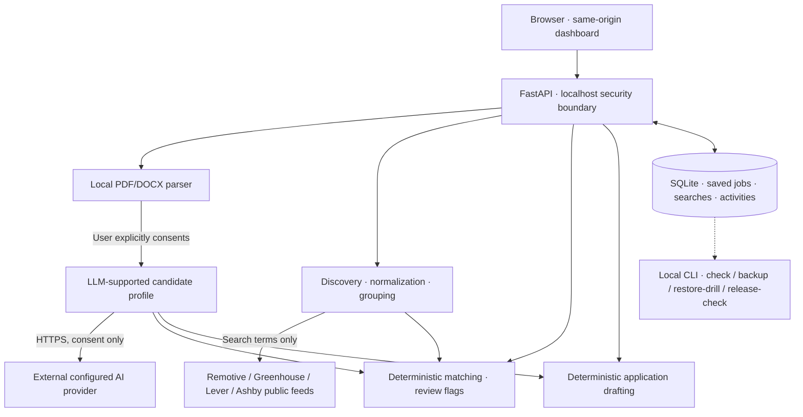

# CareerPilot AI v1.0 — Technical Architecture

## Scope

The application is **local-first, single-user**. FastAPI serves the HTML/CSS/JS dashboard and JSON API on `127.0.0.1`. It is **not** designed as a public web service. The only intentional outgoing connections are the configured consent-gated LLM provider (when analyzing a resume) and public job-feed URLs (search queries only).

## High-level architecture

The diagram describes logical flow, not an assumption that middleware is a downstream business service. HTTP requests cross the local security middleware before route handlers execute.

## Backend components

| Code path | Responsibility |
|---|---|
| `app/main.py` | FastAPI initialization, local security middleware and bundled dashboard |
| `app/core/security.py` | Host/origin protection and response headers for local operation |
| `app/api/` | HTTP contracts and endpoint composition |
| `app/schemas/` | Validated request/response contracts using Pydantic |
| `app/services/resume_parser.py` | Local PDF/DOCX extraction |
| `app/services/candidate_extractor.py` | Consent-gated external LLM profile analysis and evidence checks |
| `app/services/multi_job_discovery.py` | Multi-source public job retrieval and normalization |
| `app/services/job_grouping.py` | Grouping related job postings with geographic variants |
| `app/services/job_matching.py` | Conservative heuristic relevance and review flags |
| `app/services/job_intelligence.py` | Advanced metadata, freshness and filtering |
| `app/services/application_drafting.py` | No-network, no-storage, deterministic text drafts |
| `app/services/opportunity_store.py` | Saved opportunities and local activity history in SQLite |
| `app/services/job_watch_store.py` | User-triggered saved searches and URL seen-set in SQLite |
| `app/core/maintenance.py` | DB integrity and consistent backup tooling |
| `app/core/release.py` | Local release report and isolated-memory restore validation |
| `app/ops/__main__.py` | CLI entry points |
| `app/web/` | Native browser front end, no CDNs or JS framework dependency |

## Data & trust boundaries

| Information | Local processing | External transmission | Persistent database |
|---|---|---|---|
| Original resume upload | PDF/DOCX extracted locally | Resume-derived text goes to AI provider only after consent | Not a stored document feature |
| Candidate profile | Validated for UI, matching and drafts | Derived through provider on consent | Not intentionally stored in SQLite |
| Search query | Job discovery | Sent to configured job feeds | Saved if user chooses saved search |
| Public job listing | Grouped, ranked, displayed | Retrieved from public provider | Selected job metadata persisted if user saves |
| Application drafts | Deterministically built from profile + job description | No additional outgoing model/job-feed call | Not stored in SQLite |
| User notes & tracking | Local CRUD | Not sent to providers by these workflows | Stored in SQLite and backups |

### Heuristic scores and geographic eligibility

`technical_score` / matching values represent relative technical relevance based on rules, not probability of hiring, approved geographic eligibility, seniority qualification or verifiable commercial years. `Remote` is not a synonym for `worldwide`. Unknown posting dates are identified separately; first appearance in a user's manual saved-search check does not prove new publication.

## Data persistence

The core SQLite tables include `opportunities`, `activities`, `job_watches` and `job_watch_seen` (with SQLite internal tables as needed). Native Windows stores state under the user's app-local data area. Docker Compose uses a separate named volume mounted under `/data`: do not assume that two modes share their history.

Backups are produced through SQLite's backup mechanism. The restore drill opens the backup and copies it into an **isolated in-memory SQLite** instance for integrity/table/row-count validation. Original data is not overwritten.

## Deployment and boundaries

**Native Windows:** `python -m uvicorn app.main:app --host 127.0.0.1 --port 8000`.

**Docker local:** Compose publishes `127.0.0.1:8000:8000` on the host, and the container listens on its internal port. Bridge mode is **not authentication**; avoid public access, proxies and port forwarding.

External provider APIs may fail, change, or limit access. This version contains no scheduled alerts, automated applications, LinkedIn scraping or multi-user login. Dependency versions are ranged rather than pinned to hashes; reproducibility needs future dependency locking and scanning.

## Operational observability

- `GET /health`: basic process liveness response (not verification of external providers).
- `python -m app.ops check`: local database/provider configuration checks.
- `python -m app.ops release-check`: local readiness flags and outstanding manual checks.
- `python -m app.ops backup ...` / `restore-drill ...`: local data verification.
- `pytest -q`: automated regression tests.

See [Security policy](../SECURITY.md) and [Release checklist](release-checklist.md).
